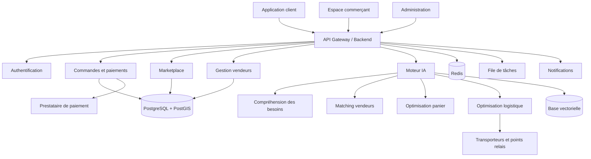

### Projet de startup : FOOD SIGNAL

### FOOD SIGNAL

Le premier marché alimentaire où le consommateur ne cherche plus ses produits : il exprime ses besoins, et le marché vient lui proposer des solutions.


Je te propose de construire FOOD SIGNAL comme une véritable entreprise technologique, et non comme un simple site de livraison de courses.

Son principe est de renverser le fonctionnement traditionnel du commerce alimentaire.

Aujourd'hui :

* Le magasin possède des produits.

* Le client parcourt le catalogue.

* Le client choisit.

* Le magasin prépare la commande.

Avec FOOD SIGNAL :

* Le client exprime ce qu'il souhaite acheter.

* L'intelligence artificielle comprend son besoin.

* La plateforme interroge les commerçants et producteurs.

* Les vendeurs proposent leurs produits et leurs conditions.

* L'IA construit la meilleure combinaison de propositions.

* Le client valide et choisit comment recevoir ses achats.

La différence fondamentale : on part de la demande du consommateur pour organiser l'offre alimentaire.

### 1\. Le concept commercial

### Un marché alimentaire inversé


FOOD SIGNAL repose sur quatre acteurs :

| Acteur | Fonction |
| ----------- | --------------------------------------- |
| Particulier | Exprime ses besoins alimentaires |
| Commerçant | Répond aux demandes |
| Producteur | Propose ses disponibilités |
| FOOD SIGNAL | Organise, compare, négocie et coordonne |

Tu ne possèdes pas de supermarché, tu ne constitues pas de stock et tu n'achètes pas les produits à l'avance.

Tu exploites une infrastructure numérique qui coordonne les transactions entre l'offre et la demande.

### 2\. Les six innovations principales

Je construirais le concept autour de six mécanismes complémentaires.


A. La commande par intention

Le client ne sélectionne pas nécessairement des références. Il formule un besoin en langage naturel, par exemple : « Je veux préparer un barbecue pour six personnes avec 50 € ».


B. Le matching alimentaire intelligent

L'IA recherche les vendeurs capables de satisfaire la demande selon le prix, la qualité, la disponibilité, l'origine et la distance.


C. La compétition commerciale

Plusieurs commerçants peuvent proposer une offre pour répondre à une même demande. Le client conserve le choix final.


D. Le panier intelligent multi-commerçants

L'IA compose un panier à partir de plusieurs vendeurs, en tenant compte du prix total, des frais et des contraintes de réception.


E. La réception universelle

Livraison à domicile, retrait en magasin, point partenaire, casier réfrigéré ou livraison groupée.


F. Le marché prédictif

L'IA apprend les habitudes d'achat, anticipe les demandes et aide les commerçants à prévoir les quantités nécessaires.

Ces six mécanismes forment un système cohérent. L'innovation ne réside pas uniquement dans l'IA : elle réside dans la manière dont la plateforme organise le marché.

### 3\. Le fonctionnement complet de la plateforme

### 3.1 Parcours du particulier

L'expérience doit être extrêmement simple. Le client doit pouvoir faire ses courses en moins de quelques minutes sans connaître les commerçants partenaires.

### Exemple d'une commande FOOD SIGNAL

Écran 1 — Expression du besoin

Client

ASSISTANT FOOD SIGNAL

Bonjour ! Que souhaitez-vous acheter aujourd'hui ?

Je souhaite préparer un repas pour 6 personnes, avec un budget de 60 €. Je veux des produits frais et de qualité.

L'IA analyse la demande...

Écran 2 — Compréhension intelligente

L'IA demande éventuellement des précisions : type de repas, préférences, quantités, allergies ou exclusions alimentaires.

Écran 3 — Recherche des vendeurs

Offre A — Commerçant local

54,90 €

Offre B — Plusieurs commerçants

49,80 €

Offre C — Producteurs locaux

57,00 €

Prix illustratifs, à confirmer par les vendeurs.

Écran 4 — Comparaison

Le client compare :

* Le prix total.

* Les produits proposés.

* Les origines.

* Les vendeurs.

* Les disponibilités.

* Les conditions de réception.

    Écran 5 — Validation

Le client valide son panier et choisit son mode de réception.

Écran 6 — Suivi

Il reçoit les confirmations des vendeurs, suit la préparation et sait quand sa commande sera disponible.

### 3.2 Le parcours du commerçant

Le commerçant ne doit pas être obligé d'utiliser un logiciel compliqué.

Il possède un espace professionnel appelé FOOD SIGNAL BUSINESS.


Ses fonctionnalités :

| Fonctionnalité | Utilité |
| --------------------- | -------------------------------- |
| Profil professionnel | Présentation de son activité |
| Catalogue | Produits et caractéristiques |
| Disponibilités | Stocks ou quantités vendables |
| Demandes reçues | Besoins des consommateurs |
| Réponse commerciale | Prix et conditions proposés |
| Gestion des commandes | Préparation et confirmation |
| Paiements | Suivi des ventes et reversements |
| Statistiques IA | Analyse de la demande |

### Exemple de fonctionnement

Un boucher reçoit une demande :

« Un client recherche 2 kg de viande pour barbecue, budget de 30 € maximum. »

Il peut répondre :

* Proposition : assortiment barbecue de 2 kg.

* Prix : 27,90 €.

* Disponibilité : samedi.

* Préparation : sur commande.

Il transmet son offre au client.

Le commerçant garde le contrôle de ses prix et de ses disponibilités.

### 4\. L'intelligence artificielle : le véritable moteur de FOOD SIGNAL

Je ne construirais pas un simple chatbot auquel on ajoute une IA.

Je développerais un ensemble de moteurs spécialisés qui travaillent ensemble.

### FOOD SIGNAL AI ENGINE

Moteur central d'intelligence artificielle

Compréhension, décision, recommandation et orchestration

AI Intent

Comprendre les besoins

AI Matching

Trouver les vendeurs

AI Pricing

Comparer les offres

AI Basket

Construire le panier

AI Logistics

Optimiser la réception

AI Forecast

Anticiper la demande

Résultat : une transaction alimentaire optimisée

Client + commerçant + commande + réception

### Les six moteurs à développer

1\. AI Intent — Compréhension du besoin

L'IA transforme une phrase libre en données structurées.

Exemple :

DEMANDE CLIENT

« Je veux faire des courses pour deux personnes, avec 80 €, pour trois jours. »

RÉSULTAT STRUCTURÉ

```json

{
  "persons": 2,
  "budget_max": 80,
  "duration_days": 3,
  "categories": [
    "fruits",
    "legumes",
    "viandes",
    "produits_laitiers",
    "epicerie"
  ],
  "delivery_preference": null
}
```

2\. AI Matching — Recherche des fournisseurs

L'IA identifie les vendeurs qui correspondent à la demande.

Elle prend en compte :

* La catégorie du produit.

* Le prix.

* La disponibilité vérifiée.

* La distance.

* La qualité documentée.

* Les conditions de préparation.

* Les horaires de réception.

3\. AI Pricing — Comparaison intelligente

Le moteur compare le coût complet, et non seulement le prix du produit.

Il intègre :

* Prix des produits.

* Frais de préparation.

* Frais de livraison.

* Frais de plateforme.

* Remises commerciales.

Il peut aussi détecter les propositions incohérentes.

Attention : les vendeurs doivent rester libres de fixer leurs prix. L'IA ne doit pas organiser artificiellement une fixation collective des prix.

4\. AI Basket — Construction du panier

L'IA cherche la meilleure combinaison de vendeurs pour respecter le budget, les préférences et le délai.

5\. AI Logistics — Organisation des réceptions

Elle regroupe les commandes selon les zones, les créneaux, les températures nécessaires et les contraintes des transporteurs.

6\. AI Forecast — Prévision de la demande

Elle aide les commerçants à anticiper :

* Les produits recherchés.

* Les périodes de forte demande.

* Les quantités probables.

* Les tendances locales.

* Les risques de rupture.

La prévision doit rester une aide à la décision, et non une commande automatique non autorisée.

### 5\. Architecture technique de la startup

En tant que développeur, tu peux construire un premier système avec une architecture modulaire, évolutive et relativement économique.

Je recommande de commencer avec un backend centralisé bien structuré plutôt que de multiplier les microservices dès le premier jour.

### 5.1 Architecture générale



### 5.2 Technologies recommandées

| Couche | Technologie |
| --------------------- | ------------------------------- |
| Application web | Next.js + TypeScript |
| Application mobile | React Native |
| Backend | NestJS |
| Base de données | PostgreSQL |
| Géolocalisation | PostGIS |
| Cache | Redis |
| Recherche | OpenSearch ou PostgreSQL |
| Recherche sémantique | pgvector |
| IA conversationnelle | API de modèle de langage |
| Optimisation | Python + OR-Tools |
| Paiements marketplace | Stripe Connect ou équivalent |
| Notifications | Firebase / Web Push |
| Cartographie | Mapbox ou Google Maps |
| Hébergement | Infrastructure cloud européenne |
| Monitoring | OpenTelemetry + Sentry |

### 5.3 Les modules métier

Je séparerais le backend en modules :

```text
food-signal/
│
├── apps/
│ ├── customer-web/
│ ├── merchant-dashboard/
│ ├── admin-dashboard/
│ └── mobile-app/
│
├── backend/
│ ├── auth/
│ ├── users/
│ ├── merchants/
│ ├── products/
│ ├── availability/
│ ├── requests/
│ ├── offers/
│ ├── matching/
│ ├── baskets/
│ ├── orders/
│ ├── payments/
│ ├── delivery/
│ ├── notifications/
│ └── traceability/
│
├── ai/
│ ├── intent-engine/
│ ├── matching-engine/
│ ├── pricing-engine/
│ ├── basket-engine/
│ ├── logistics-engine/
│ └── forecasting-engine/
│
└── infrastructure/
    ├── database/
    ├── redis/
    ├── queues/
    └── monitoring/
```

Point architectural important : l'IA ne doit jamais être responsable seule de la validation d'un prix, d'une disponibilité ou d'une commande. Les décisions commerciales finales doivent être vérifiées par des règles métier déterministes et les confirmations des vendeurs.

### 6\. Le MVP : première version commercialisable

Le plus important est de ne pas essayer de développer les six moteurs IA dès le départ.

Tu dois d'abord vérifier une hypothèse :

Est-ce que des particuliers sont prêts à exprimer leurs besoins alimentaires plutôt que de parcourir les catalogues des magasins ?

### 6.1 Fonctionnalités de la première version

MVP recommandé

### FOOD SIGNAL — Version 1.0


Espace particulier

* Création de compte.

* Assistant IA conversationnel.

* Formulaire de demande alimentaire.

* Choix du budget.

* Réception des offres.

* Comparaison des propositions.

* Validation de commande.

* Choix du mode de réception.

    Espace commerçant

* Inscription professionnelle.

* Gestion des produits.

* Réception des demandes.

* Création de propositions.

* Gestion des disponibilités.

* Confirmation des commandes.

    Administration

* Validation des vendeurs.

* Supervision des transactions.

* Gestion des réclamations.

* Contrôle des offres.

* Suivi des paiements.

* Statistiques d'activité.

    Intelligence artificielle

* Compréhension des demandes.

* Catégorisation des produits.

* Matching des vendeurs.

* Comparaison des propositions.

* Recommandation du panier.

### 6.2 Ce qu'il ne faut pas développer au départ

| Fonctionnalité | Décision |
| ----------------------------- | ---------------------- |
| Application mobile native | Plus tard |
| Reconnaissance photo du frigo | Plus tard |
| Prévision des achats | Plus tard |
| Casiers réfrigérés | Partenaires uniquement |
| Livraison autonome | Plus tard |
| IA prédictive avancée | Plus tard |
| Marketplace internationale | Plus tard |

Une application web responsive suffit pour tester le concept.

### 6.3 Planning de développement indicatif

* Semaines 1 à 2 — Conception

    Modèle de données, parcours utilisateur, règles commerciales et maquettes.

* Semaines 3 à 5 — Backend

    Comptes, commerçants, demandes, offres, commandes et disponibilité.

* Semaines 6 à 7 — Interface

    Espace particulier, espace vendeur et administration.

* Semaines 8 à 9 — Intelligence artificielle

    Compréhension des demandes et moteur de matching.

* Semaines 10 à 11 — Paiement et réception

    Prestataire de paiement, notifications et intégration des solutions de livraison.

* Semaine 12 — Pilote

    Tests avec de vrais clients et commerçants.

Planning indicatif pour un développeur expérimenté avec un périmètre volontairement limité. Les intégrations et obligations réglementaires peuvent prolonger le calendrier.

### 7\. Modèle économique

FOOD SIGNAL ne doit pas dépendre d'une seule source de revenus.

Je recommande de commencer par une commission sur les transactions, puis d'ajouter les services professionnels.

### 7.1 Sources de revenus

| Revenus | Fonctionnement |
| ------------------------- | -------------------------------------------- |
| Commission commerciale | Pourcentage de la transaction |
| Frais de service | Participation du client |
| Abonnement commerçant | Outils professionnels avancés |
| Abonnement particulier | Avantages et services premium |
| Services logistiques | Coordination de réception |
| Mise en avant sponsorisée | Visibilité commerciale clairement identifiée |
| Outils IA B2B | Prévisions et analyse de la demande |

Il faut éviter de facturer simultanément trop de services dès le lancement.

### 7.2 Simulation économique

Voici une simulation hypothétique, et non une prévision de chiffre d'affaires.

Hypothèses :

* Panier moyen : 55 €.

* Commission plateforme : 10 %.

* Frais de service client : 1 €.

* Pas de marge sur les produits.

* Livraison facturée séparément et reversée au prestataire.

Simulation mensuelle

Commandes mensuelles

1 000

Panier moyen

55 €

Commission

10 %

Frais de service client

1.00 €

Volume d'affaires mensuel des vendeurs

Commissions

### 5 500 €

Frais de service

### 1 000 €

Chiffre d'affaires théorique de la plateformeAvant frais de paiement, personnel, technologie, acquisition, remboursements, fiscalité et autres charges.

### 7.3 Exemple de progression commerciale

| Indicateur | Phase pilote | Développement | Expansion |
| ------------------------- | ------------ | ------------- | --------- |
| Commerçants actifs | 15 | 50 | 150 |
| Clients actifs | 300 | 2 000 | 8 000 |
| Commandes/mois | 300 | 2 500 | 10 000 |
| Panier moyen hypothétique | 45 € | 50 € | 55 € |

Ce sont des objectifs de travail à valider, pas des résultats garantis.

### 8\. Stratégie de lancement dans une seule ville

Je recommande de ne pas lancer immédiatement FOOD SIGNAL partout.

Le modèle doit d'abord fonctionner dans une zone géographique compacte.

### 8.1 Choix du territoire

Ne choisis pas une ville uniquement parce qu'elle est grande.

Évalue :

* La densité de commerces alimentaires.

* La présence de producteurs et fournisseurs.

* Le nombre de commerces indépendants.

* La densité de population.